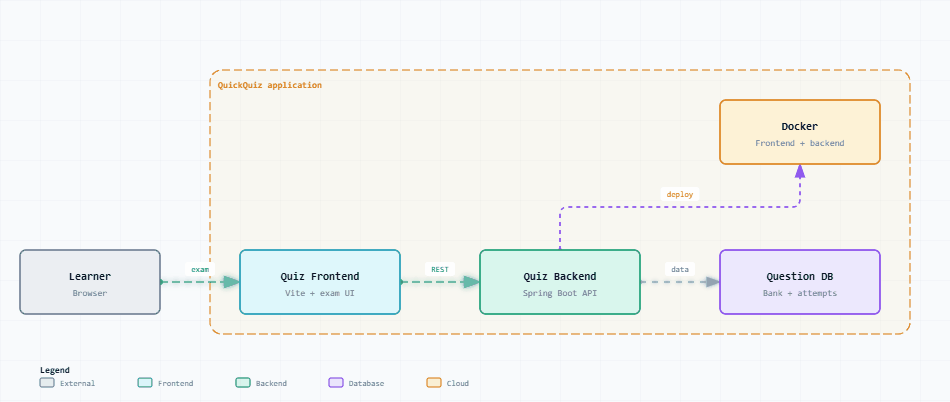

# 📝 QuickQuiz — 智能题库与在线测验系统


> **安全认证 · 智能组卷 · 错题本反馈**

QuickQuiz 是一个基于前后端分离架构的个人题库管理与在线测验平台。核心致力于提供便捷的题目录入体验和科学的复习机制，帮助用户高效构建和管理个人知识库，随时随地进行自我测试。

---

## ✨ 核心功能

- 🔐 **安全认证**：基于 Spring Security + JWT 的无状态用户登录与注册。
- 📚 **题库管理**：支持单选题、多选题、判断题等多种题型的结构化录入与灵活编辑。
- 🧠 **智能组卷**：支持按知识点标签筛选、随机抽题进行模拟测验。
- 📈 **数据反馈**：自动记录错题（错题本），并提供基础的学习进度与成绩视图。

---

## 🚀 快速启动

### 1. 环境准备

请确保你的电脑上已安装以下环境：

- JDK 17
- Node.js（v18+）
- MySQL（v8.0+）

### 2. 后端部署

1. 在 MySQL 中创建名为 `quickquiz_db` 的数据库：

   ```sql
   CREATE DATABASE quickquiz_db CHARACTER SET utf8mb4 COLLATE utf8mb4_unicode_ci;
   ```

---

## 🖼️ 界面预览


---

## 📂 项目结构

```text
QuickQuiz/
├── quickquiz-frontend/      # 前端（React 18 + Vite + Tailwind CSS）
│   └── src/                 # pages / components / router / context / layouts
├── QuickQuiz-backend/       # 后端（Spring Boot 3 + Spring Security + JPA）
│   └── src/main/java/...    # controller / dto / entity / exception / ai / ocr 等
├── docker/                  # docker-compose、前后端 Dockerfile 与 nginx.conf
├── docs/                    # stable-runbook、架构图与题库课程资料
├── output/playwright/       # Playwright 测试输出
└── README.md
```

---

## 🛠️ 技术栈

### 前端（Frontend）

- **核心框架**: React 18 + Vite
- **UI & 样式**: Tailwind CSS v4
- **路由与状态**: React Router DOM + Zustand（待定）

### 后端（Backend）

- **核心框架**: Java 17 + Spring Boot 3.2.5
- **安全鉴权**: Spring Security + JWT（JSON Web Token）
- **持久层框架**: Spring Data JPA / Hibernate
- **数据库**: MySQL 8.x + HikariCP

---

## 📖 Stable Runbook

本地开发、Docker 健康检查、CORS 与 API base URL 相关说明，见 [docs/stable-runbook.md](docs/stable-runbook.md)。

---

## 🖼️ 动态系统架构图



- [打开交互式动态架构图](docs/architecture/dynamic-archify-architecture.html)
- [查看架构源数据](docs/architecture/dynamic-archify-architecture.json)
